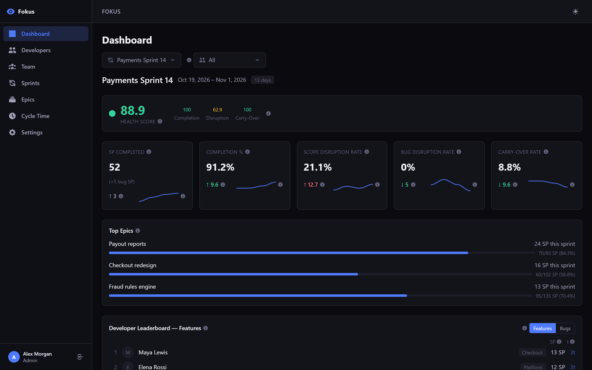
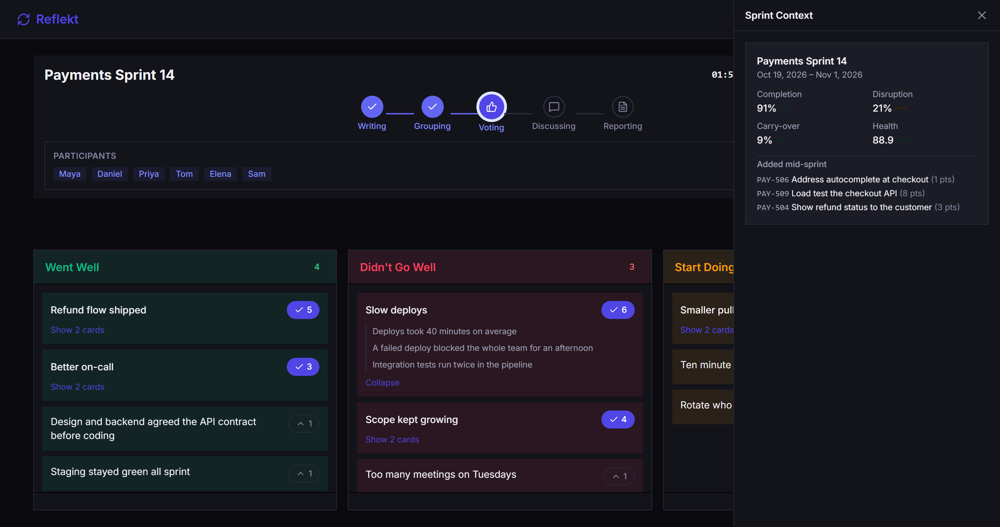
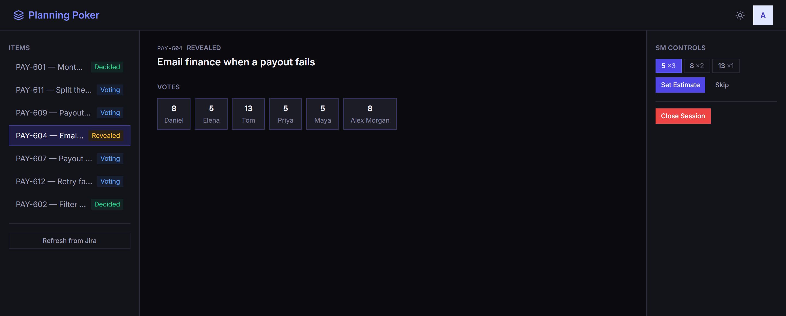
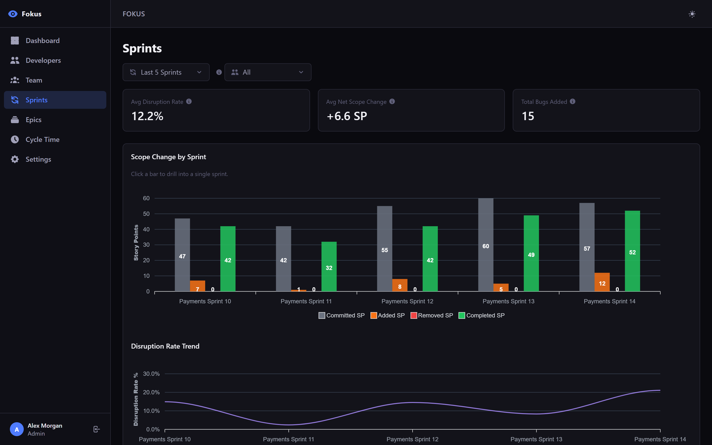
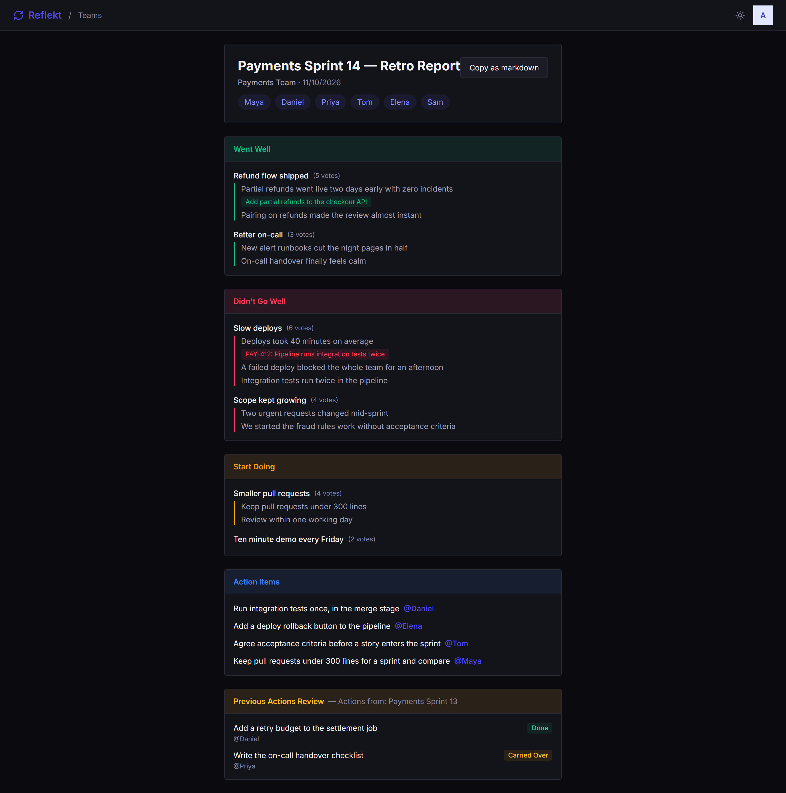

# Sprint Rituals

**One application for a Scrum team's sprint rituals, built entirely by AI agents.**

Sprint Rituals is one application whose three tools work on the same sprints: Fokus syncs the sprint from Jira and measures it, Poker estimates the next sprint's tickets, and Reflekt runs the retrospective. They share one sign-in and run in one process. Every feature was specified, planned, implemented and reviewed by [Claude Code](https://docs.anthropic.com/en/docs/claude-code) agents, and the records of that work are kept here next to the code.

     



## One application, one flow

A team's sprints live in Jira. Fokus syncs them, with their tickets and status history, and works out how each sprint went. Before the next sprint, the Scrum Master opens a Poker session on it: the tickets come from Jira through Fokus, the team votes, and each agreed estimate is written back to the ticket's story points in Jira. When the sprint ends, the team runs its retro in Reflekt on that same sprint, and the room can open the sprint's team-level figures from Fokus beside the cards. One Google sign-in covers all three.

```
Jira ──── sprints, tickets, status history ───▶ Fokus
Fokus ─── "sprint synced" event ──────────────▶ Reflekt   keeps its own copy of each sprint
Reflekt ─ which sprints? team figures? ───────▶ Fokus     gRPC, answered from Fokus's data
Poker ─── which sprints? which tickets? ──────▶ Fokus ──▶ Jira   gRPC, tickets read live
Poker ─── agreed estimate ────────────────────▶ Fokus ──▶ Jira   story points, before the item counts as decided
Identity ─ one Google sign-in, one cookie ────▶ Fokus, Reflekt, Poker
```

Only team-level figures cross from Fokus to Reflekt; no per-developer numbers reach the retro. Nothing flows from Reflekt back to Fokus.

## Why this repo

| If you want... | You get... |
|---|---|
| **Tools for a Scrum team** | Sprint analytics, planning poker and retrospectives on the same sprints, with one sign-in. Guests join a retro or a poker room with a link and a name. Deploys as one app to a free Azure App Service. |
| **To see how agents build software** | A full application, not a demo, with the specs, plans, reviews and lessons behind each feature. Start at [How it was built](#how-it-was-built). |
| **A .NET modular monolith and Vue reference** | Four modules in one host, each with its own database, talking through gRPC contracts and integration events; domain-driven design with vertical slices; three Vue apps. Start at the [architecture decisions](docs/architecture/decisions.md). |

## The three tools

**Fokus: sprint analytics.** Syncs sprints, issues and status history from Jira, and test executions from Xray when it is switched on. For each sprint it computes a health score from completion, disruption and carry-over, with trends over the last sprints, and flags tickets that have sat in several sprints and work added mid-sprint. Other views cover developers, scope change per sprint, epics, cycle time and, with Xray, QA.

**Poker: planning poker.** The Scrum Master starts a session on a sprint, and its tickets load from Jira. Everyone votes on a Fibonacci scale; votes stay hidden until the Scrum Master reveals them, or until everyone connected has voted. The agreed estimate is written to Jira before the ticket is marked decided. A free session without a sprint takes typed items instead.

**Reflekt: retrospectives.** A retro is started on one or more sprints from Fokus and moves through five phases: Writing, Grouping, Voting, Discussing and Reporting. Cards, groups, votes and phase changes reach everyone in the room at once. Action items get an assignee and come back at the next retro to be marked done, carried over or dropped.

<table>
  <tr>
    <td width="50%" valign="top"><a href="docs/images/reflekt-context.png"></a></td>
    <td width="50%" valign="top"><a href="docs/images/poker-room.png"></a></td>
  </tr>
  <tr>
    <td align="center"><b>Retro:</b> the cards, with the sprint's figures from Fokus beside them</td>
    <td align="center"><b>Poker:</b> the sprint's tickets, votes revealed, estimate to Jira</td>
  </tr>
</table>

<details>
<summary><b>See more: scope change across sprints, and a retro report</b></summary>
<br>

<br><br>

</details>

The people, team, tickets and figures in these pictures are invented.

## Features

| Feature | What it does |
|---|---|
| **One sign-in** | Google sign-in with a cookie, shared by the three tools. The first person to sign in becomes the administrator; the administrator invites everyone else. |
| **Jira sync** | Pulls sprints, issues and their status history from a Jira board; Xray test executions when switched on. |
| **Sprint health** | A health score with green, amber and red levels, metric cards with trend lines, top epics and a developer leaderboard. Thresholds and weights are set in Settings. |
| **Analytics views** | Developers, sprints (scope change and disruption), epics, cycle time with a stage funnel, and QA with Xray. Most can be filtered by sub-team. |
| **Planning poker** | Hidden votes, reveal by the Scrum Master or when everyone has voted, and the agreed estimate written back to Jira. |
| **Live retro room** | Cards, groups, votes and phase changes reach everyone at once over SignalR. During Writing, other people's card text is removed on the server before it is sent. |
| **Sprint figures in the retro** | The retro room can open the sprint's team-level figures from Fokus. If Fokus can't be reached, the retro still runs. |
| **Retro extras** | Configurable columns, a vote budget per participant, evidence links (Jira, GitHub or any link) with their title fetched in the background, a phase timer with a chime, an "I'm done" button, and a report that copies as Markdown. |
| **Guests** | Retro and poker participants can join with a display name and no account. |
| **Light and dark themes** | In all three apps. |

## Architecture at a glance

One ASP.NET Core host composes four modules and serves the three Vue apps. Each module has its own SQLite database, and modules reach each other only through contracts.

```
Browser: /dashboard/ (Fokus) · /retro/ (Reflekt) · /poker/ (Poker)  ── Vue 3 apps
   │  HTTP: /api, /auth                         ▲  SignalR: /hubs/sprint, /hubs/retro, /hubs/poker
   ▼                                            │
┌─ Host: one process ────────────────────────────────────────────────────────┐
│   Identity          Fokus              Reflekt            Poker             │
│   sign-in, people   Jira/Xray sync,    retros, reports    planning rooms    │
│                     sprint figures                                          │
│   identity.db       fokus.db           reflekt.db         poker.db          │
│                                                                             │
│   between modules:  gRPC contracts on their own HTTP/2 port                 │
│                     integration events on an in-memory MassTransit bus      │
│   inside a module:  aggregates raise domain events; after the save,         │
│                     handlers push the changes to the browser over SignalR   │
└─────────────────────────────────────────────────────────────────────────────┘
          │ REST                       │ GraphQL
          ▼                            ▼
         Jira                         Xray
```

| Layer | Stack |
|---|---|
| **Backend** | .NET 10, ASP.NET Core, [FastEndpoints](https://fast-endpoints.com/), FluentValidation, Mapster, SignalR |
| **Between modules** | gRPC code-first (protobuf-net.Grpc), MassTransit with the in-memory transport |
| **Data** | EF Core 10 with SQLite, one database per module; migrations apply on start-up |
| **Sign-in** | Google OAuth with cookies, in the Identity module; guest tokens for retro and poker participants |
| **Frontend** | Vue 3, TypeScript, Pinia, Tailwind CSS 4, ApexCharts, built with Vite into the host's `wwwroot/` |
| **API reference** | OpenAPI with the Scalar UI, in the Development environment |
| **Tests** | xUnit v3, AwesomeAssertions |

The binding decisions are in [docs/architecture/decisions.md](docs/architecture/decisions.md), with each product's architecture beside it.

## Quick start

You need the [.NET 10 SDK](https://dotnet.microsoft.com/download) and [Node.js](https://nodejs.org/) 20.19+ or 22.12+. Everyone signs in with Google, so you also need a Google OAuth client.

**1. Set the Google credentials** on the host project. Use `dotnet user-secrets`, never a committed file:

```powershell
dotnet user-secrets set "Google:ClientId" "<client-id>" --project src/Host
dotnet user-secrets set "Google:ClientSecret" "<client-secret>" --project src/Host
```

**2. Build the three apps** into the host's `wwwroot/`:

```powershell
cd client
npm ci
npm run build
cd ..
```

**3. Start the host:**

```powershell
dotnet run --project src/Host
```

It listens on `http://localhost:5100` and serves the apps at `/dashboard/`, `/retro/` and `/poker/`. It creates the four SQLite databases (`identity.db`, `fokus.db`, `reflekt.db`, `poker.db`) under `data/` on start. The first person to sign in becomes the administrator.

<details>
<summary><b>Creating the Google OAuth client</b></summary>
<br>

In the [Google Cloud Console](https://console.cloud.google.com/), under APIs & Services → Credentials, create an OAuth 2.0 Client ID of type Web application and add `http://localhost:5100/auth/callback` as an authorized redirect URI. Store its ID and secret with the commands in step 1.
</details>

<details>
<summary><b>Syncing sprints from Jira</b></summary>
<br>

Fokus needs a Jira Cloud site and an API token. Set them on the host project:

```powershell
dotnet user-secrets set "Jira:InstanceUrl" "https://<your-site>.atlassian.net" --project src/Host
dotnet user-secrets set "Jira:Email" "<jira-account-email>" --project src/Host
dotnet user-secrets set "Jira:ApiToken" "<jira-api-token>" --project src/Host
dotnet user-secrets set "Jira:ProjectKey" "<project-key>" --project src/Host
```

Then, in the dashboard, open Settings, choose the board, and use **Sync from Jira** on the Sync tab. For Xray test executions, set `Xray:ClientId` and `Xray:ClientSecret` the same way, or use the Xray tab in Settings.
</details>

<details>
<summary><b>Working on the frontend</b></summary>
<br>

Run an app's Vite dev server instead of rebuilding. It forwards API calls to the host on port 5100:

```powershell
cd client
npm run dev:dashboard   # http://localhost:5171/dashboard/
npm run dev:retro       # http://localhost:5172/retro/
npm run dev:poker       # http://localhost:5173/poker/
```
</details>

### Tests and build

From the repository root:

```powershell
# Backend: every test project in the solution
dotnet test SprintRituals.slnx

# Frontend: type-check and production build of the three apps
cd client
npm ci
npm run build
```

The tests need no Google or Jira credentials. GitHub Actions runs both on every push and pull request.

### Deploy

The whole application deploys as one app to a free (F1) Linux Azure App Service, single instance, with the SQLite files on the app's persistent storage. `deploy/deploy.ps1` builds the apps, publishes the host and deploys it. It needs a target: pass `-AppName` and `-ResourceGroup`, or copy `deploy/deploy-config.example.ps1` to `deploy/deploy-config.ps1` (git-ignored) and fill it in. The same script runs from GitHub Actions only when started by hand.

```powershell
.\deploy\deploy.ps1 -AppName <APP_NAME> -ResourceGroup <RESOURCE_GROUP>
```

Creating the Azure resources, the app settings and the sign-in redirect is covered in [docs/deployment-azure.md](docs/deployment-azure.md).

## How it was built

Every line of code, every test and every document here was written by AI agents working as a team, with a human owner deciding what to build and approving each step. Separate agents take separate roles and hand work to each other through files:

```
Owner → PO (spec) → Architect (plan, reviewed by a critic) → Developer (implement)
      → Architect (done check) + Reviewer (code review) → Done → Learner (lessons into rules)
```

The pipeline is [Nexus](https://github.com/DotNetLabX/claude-nexus), a set of Claude Code plugins, enabled for this repo in `.claude/settings.json`. Fokus and Reflekt began as separate projects and were brought into this repo as modules, with their records; Poker was built here.

| Where | What you find |
|---|---|
| `docs/specs/` | One folder per feature or ad-hoc change: `definition/` holds the spec, `delivery/` the plan, the implementation record, the reviews, the questions asked, the lessons and the summary. `docs/specs/fokus/` and `docs/specs/reflekt/` hold the records carried over from the original projects. |
| `docs/proposals/` | Design proposals and research written before larger changes |
| `docs/architecture/decisions.md` | The architecture decision register |
| `docs/conventions/` | The coding conventions and project rules the agents follow |
| `docs/kb/` | The knowledge base: business rules, formulas and edge cases |
| `docs/plugin-feedback/` | Problems found in the agent tooling while building, written up for the plugin |

### Finding your way around

| Path | What's there |
|---|---|
| `src/Host/` | The one web project: composes the modules, serves the apps, applies the migrations |
| `src/Services/` | The modules: `Identity`, `Fokus`, `Reflekt`, `Poker`, each split into `API` (one folder per feature slice), `Domain` and `Persistence`, with their test projects |
| `src/BuildingBlocks/` | Shared libraries; `Blocks.Contracts` holds the gRPC contracts and integration events between modules |
| `src/Modules/` | The Jira and Xray clients |
| `client/apps/` | The three Vue apps: `dashboard` (Fokus), `retro` (Reflekt), `poker` (Poker); `client/packages/shared` holds what they share |
| `deploy/`, `.github/workflows/` | The deploy and provisioning scripts, CI and the manual deploy workflow |
| `docs/product/` | The product docs, per product |
| `docs/backlog.md` | The feature sequence |
| `CLAUDE.md`, `.claude/` | The instructions and agent setup as they were used |

## Design decisions

Deliberate choices, not oversights:

| Decision | Why |
|---|---|
| One host, separate modules | One process is cheap to run and deploy. Each module keeps its own API, domain, persistence and database, and talks to the others only through gRPC contracts and integration events, so a module can move to its own service by splitting the host. |
| One SQLite database per module | No module reads another's tables. SQLite keeps hosting free. |
| One instance | The in-memory message bus, SignalR without a backplane and file-based SQLite all assume one process. Scaling out needs a decision first. |
| Fokus owns the sprint data | Reflekt and Poker never keep sprints of their own as the source of truth: they ask Fokus, and Reflekt keeps only a copy of each sprint's name and state, refreshed on every sync. |
| Only team-level figures reach the retro | The contract Fokus answers Reflekt with has no per-developer data, so a retro can't single anyone out. |
| A retro covers one or more sprints | When a retro is skipped, the next one covers two sprints. |
| The estimate is written to Jira first | In a sprint-bound poker session an item counts as decided only after Jira accepts its story points; if Jira refuses, the item stays open and can be retried. |
| Guests don't need accounts | A link and a display name are enough to join a retro or a poker room. Guests get a token and no person record. |
| Plain DDD identity | People and users are the Identity module's own aggregates, with the role as a claim. ASP.NET Core Identity is not used. |
| No MediatR, no Application layer | Each FastEndpoints endpoint is the handler. Calculations live in the domain: Fokus's analyzers are domain services. |
| Card text is hidden on the server | During Writing, other people's text is removed before it's sent, so it can't be read from the browser. |

## License

[MIT](LICENSE)
